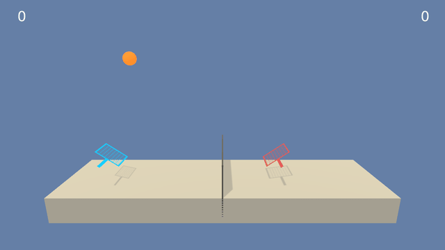

# Project 3: Collaboration and Competition

Two agents trained with MADDPG (Multi-Agent Deep Deterministic Policy Gradient) to play the Unity ML-Agents **Tennis** environment. The environment was solved in **896 episodes**, after a 500-episode random warm-up that fills the replay buffer. See [Report.md](Report.md) for the method, hyperparameters and results.



*The trained agents playing without exploration noise (first 400 steps of an episode).*

## Project Details

Two agents control rackets to bounce a ball over a net.

**Rewards**
- **+0.1** when an agent hits the ball over the net.
- **−0.01** when an agent lets the ball hit the ground or hits it out of bounds.

The goal of each agent is to keep the ball in play.

**State space:** each agent receives its own local observation of **8 variables**: the position and velocity of the ball and of its racket. The environment stacks the last 3 observations, so each agent's state vector has **24 values**.

**Action space:** **2 continuous actions** per agent, each in [−1, 1]:
1. Movement toward or away from the net.
2. Jumping.

**When the environment is solved**
- After each episode, the rewards of each agent are summed (without discounting), giving one score per agent. The episode's score is the **maximum** of the two.
- The environment is solved when the **average of these scores over 100 consecutive episodes is at least +0.5**.

## Getting Started

### 1. Install the dependencies

The code requires Python 3 and PyTorch. It was tested with Python 3.10, PyTorch 2.14, NumPy 2.2, Matplotlib 3.10 and `unityagents` 0.4.0.

```bash
conda create -n tennis python=3.10
conda activate tennis

pip install torch numpy matplotlib
pip install "protobuf==3.20.3" grpcio pyyaml docopt pillow
pip install --no-deps unityagents==0.4.0
```

`unityagents` 0.4.0 declares outdated requirements (for example `torch==0.4.0`), so it is installed with `--no-deps`. Its real runtime dependencies are installed by the line above it. It needs `protobuf` 3.20.x or lower.

### 2. Download the environment

Download the environment that matches your operating system:
- Linux: [click here](https://s3-us-west-1.amazonaws.com/udacity-drlnd/P3/Tennis/Tennis_Linux.zip)
- Mac OSX: [click here](https://s3-us-west-1.amazonaws.com/udacity-drlnd/P3/Tennis/Tennis.app.zip)
- Windows (32-bit): [click here](https://s3-us-west-1.amazonaws.com/udacity-drlnd/P3/Tennis/Tennis_Windows_x86.zip)
- Windows (64-bit): [click here](https://s3-us-west-1.amazonaws.com/udacity-drlnd/P3/Tennis/Tennis_Windows_x86_64.zip)

Unzip it in the root of this repository. The default path is the Linux build, `Tennis_Linux/Tennis.x86_64`. On other systems, pass the path with `--env`, for example `--env Tennis.app`.

## Instructions

### Files

| File | Contents |
|---|---|
| `train.py` | Training loop (command-line script) |
| `test.py` | Evaluation of trained agents, without exploration noise |
| `maddpg_agent.py` | MADDPG agent, replay buffer and OU noise |
| `model.py` | Actor and critic networks |
| `checkpoint_actor.pth`, `checkpoint_critic.pth` | Weights of the trained actor and critic |
| `checkpoint.pth` | Full training checkpoint (networks, optimizers, score history) |
| `scores.png`, `train.log` | Score plot and training log |
| `trained_agent.gif` | Recording of the trained agents |
| `Report.md` | Description of the implementation and results |

### Train the agents

```bash
python train.py --no-resume
```

Training stops when the environment is solved. It saves the weights to `checkpoint_actor.pth` and `checkpoint_critic.pth`, and the score plot to `scores.png`. Progress is printed and written to `train.log`. Without `--no-resume`, training continues from `checkpoint.pth` if that file exists.

Useful options (`python train.py --help` lists all of them):
- `--episodes N`: maximum number of episodes
- `--warmup-episodes N`: random-action episodes that fill the replay buffer before learning
- `--separate`: give each agent its own actor and critic instead of sharing them
- `--graphics`: show the Unity window while training (slower)

### Watch or evaluate the trained agents

```bash
python test.py --graphics --episodes 3    # watch 3 episodes
python test.py --episodes 100             # average score over 100 episodes
```
