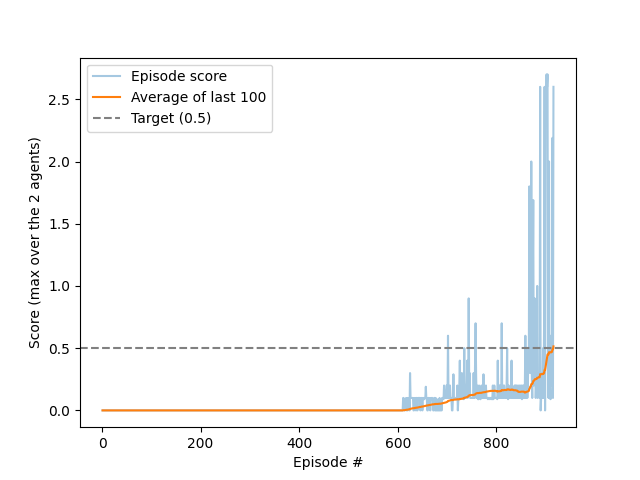

# Report: Collaboration and Competition (Tennis)

## 1. Summary

Two agents were trained with **MADDPG** (Multi-Agent Deep Deterministic Policy Gradient) to play Tennis. Both agents share one actor and one centralized critic.

The environment was **solved in 896 episodes**: the average score over episodes **797–896** was **0.502**, after taking the maximum over both agents each episode. Before learning started, 500 random-action episodes filled the replay buffer (see 2.4). These are not counted in the 896 episodes.

## 2. Learning Algorithm

### 2.1 MADDPG

MADDPG extends DDPG, an actor-critic method for continuous actions, to several agents. It uses **centralized training with decentralized execution**:

- **Actor (decentralized):** maps an agent's own observation to its action. Only the actor is needed to play.
- **Critic (centralized):** estimates the Q-value from the observations **and actions of all agents**. It is only used during training.

Because the critic sees the other agent's action, the other agent's behaviour is part of its input instead of an unexplained change in the environment. This makes learning more stable when the agents influence each other, as they do in Tennis.

Each learning step, for agent *i*:

1. **Critic update.** The target is the TD target `y = rᵢ + γ · Q′(s′, a′₁, a′₂) · (1 − doneᵢ)`. The next actions `a′` come from the target actors. The critic minimizes the mean squared error between `Q(s, a₁, a₂)` and `y`. Its gradients are clipped to a norm of 1.
2. **Actor update.** The actor maximizes `Q(s, μ(oᵢ), a₋ᵢ)`. Agent *i*'s action comes from the current actor; the other agent's action comes from its current actor too, but without gradients, so only agent *i*'s side is trained in this update.
3. **Soft update** of the target networks: `θ_target ← τ·θ_local + (1 − τ)·θ_target`.

### 2.2 Shared networks

Tennis is symmetric: each agent observes the court from its own side. So **both agents use the same actor and critic**, and every learning step performs one update from each agent's point of view.

To make one critic usable for both agents, its input is always ordered with the learning agent first:
`[own observation, other observation]` and `[own action, other action]`. Each update uses that agent's own reward and done flag.

Sharing was the decisive design choice. In an earlier version with separate networks per agent, one agent learned to hit the ball while the other did not. Since rallies need both agents, the score stayed around 0.05. With shared networks, whatever one agent learns is immediately available to the other.

(`train.py --separate` trains separate networks per agent instead.)

### 2.3 Exploration

- **Ornstein–Uhlenbeck noise** is added to each action, with one independent process per agent. Actions are then clipped to [−1, 1].
- The noise is multiplied by a scale that starts at 1.0 and decays by 0.999 after every episode. It had reached 0.41 by the end of training.

### 2.4 Replay buffer and warm-up

- One replay buffer stores every environment step, holding both agents' observations, actions, rewards, next observations and done flags.
- Rewards are very sparse at the start, because random rackets rarely hit the ball. So before learning, **500 episodes with uniformly random actions** fill the buffer (9,484 steps, including 120 hits over the net). These episodes do not update the networks and are not part of the score history or the plot.

### 2.5 Hyperparameters

| Hyperparameter | Value |
|---|---|
| Replay buffer size | 1,000,000 |
| Batch size | 256 |
| Discount factor γ | 0.99 |
| Soft update τ | 0.001 |
| Actor learning rate | 1e-4 |
| Critic learning rate | 1e-3 |
| Critic weight decay | 0 |
| Learning frequency | every environment step, 1 update per agent's point of view |
| Critic gradient clipping (max norm) | 1.0 |
| OU noise θ / σ / μ | 0.15 / 0.2 / 0 |
| Noise scale: start / decay per episode / minimum | 1.0 / 0.999 / 0 |
| Random warm-up episodes | 500 |
| Max steps per episode | 1000 |
| Optimizer | Adam |
| Random seed | 2 |

### 2.6 Network Architectures

**Actor** (one network, shared by both agents):

| Layer | Size | Activation |
|---|---|---|
| Input: own observation | 24 | |
| Fully connected | 256 | ReLU |
| Fully connected | 128 | ReLU |
| Output: actions | 2 | tanh, so actions are in [−1, 1] |

**Critic** (one network, shared by both agents):

| Layer | Size | Activation |
|---|---|---|
| Input: both observations (own first) | 48 | |
| Fully connected | 256 | ReLU |
| Concatenate both actions (own first) | 256 + 4 | |
| Fully connected | 128 | ReLU |
| Output: Q-value | 1 | linear |

The hidden layers are initialized uniformly in ±1/√(fan-in). The output layers are initialized in ±3·10⁻³, so the initial actions and Q-values are close to 0.

## 3. Results

### Plot of Rewards

The plot shows the score of each training episode (the maximum over both agents) and the average over the last 100 episodes. The x-axis starts after the 500 warm-up episodes.

| Milestone | Episode |
|---|---|
| First ball hit over the net | 611 |
| 100-episode average ≥ 0.1 | 709 |
| 100-episode average ≥ 0.25 | 830 |
| Highest episode score (2.7) | 836 |
| **100-episode average ≥ 0.5 (solved)** | **896** |

**The environment was solved in 896 episodes:** the average over episodes 797–896 is **0.502**. The full training output for this run is in `train.log`, from line 7545 onward.

For about 600 episodes the agents scored nothing. Once they started hitting the ball, learning was fast: from the first hit to the solved average took under 300 episodes. The best episodes (scores 2.6–2.7) ran the full 1000 steps allowed per episode, so the rally only ended at the step limit.

### Evaluation

Run without exploration noise (`python test.py`), the trained agents scored **2.6, 2.7, 0.0, 2.6 and 2.7** in 5 episodes (average 2.12). The result is deterministic: the policy has no noise, and the environment starts with the same sequence of serves every time it is launched. Most serves lead to a full-length rally. One serve position (episode 3) is always missed.

## 4. Ideas for Future Work

1. **Prioritized experience replay.** Rewarded transitions were rare: only 120 of the 9,484 warm-up steps contained a hit. Sampling transitions with a large TD error more often would let the critic learn from hits sooner, which could shorten the ~600-episode period with no progress. A simpler version is to always mix a fixed share of rewarded transitions into each batch.
2. **Twin critics and target policy smoothing (TD3 / MATD3).** Using the minimum of two critics reduces the overestimation of Q-values that DDPG-based methods are prone to. A delayed actor update would also stop the actor from following an untrained critic too early.
3. **Tuning the exploration schedule and the warm-up.** The noise scale was still 0.41 when the environment was solved. A schedule tied to performance, for example lowering the noise once the average score rises, could allow more precise play sooner. The length of the random warm-up (500 episodes) was not tuned either.
4. **Fixing the missed serve.** The trained agents always miss one specific starting position. Evaluating on more starting positions and training longer after reaching 0.5 should make the policy more robust.
5. **Comparing with MAPPO.** Multi-Agent PPO, an on-policy method with a centralized value function, is a strong alternative on cooperative tasks. Comparing it with MADDPG on Tennis, especially in sample efficiency and stability, would show whether the off-policy replay buffer is an advantage here.
